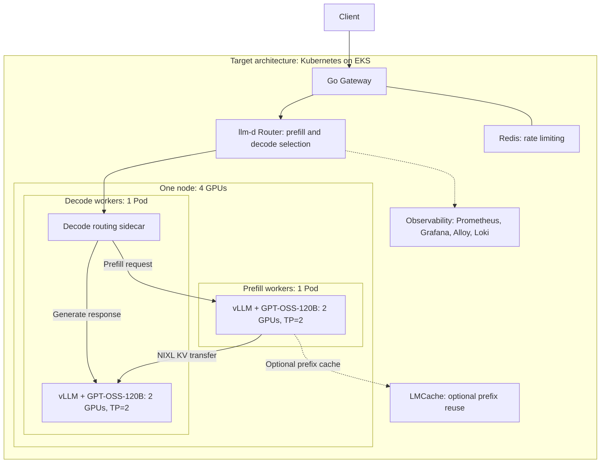

# Inference server

An infrastructure project for distributed LLM serving on Kubernetes. I built this project to learn how distributed inference work.

## Architecture

The current stack combines a Go API gateway, llm-d routing, vLLM workers,
Redis admission control, and optional external KV caching through LMCache.

The project explores how to design, deploy, and benchmark distributed LLM
inference systems. A Go gateway handles model policies and rate
limiting, while llm-d routes requests to vLLM workers. Experiments cover external
KV-cache reuse with LMCache, worker replacement, and metrics-driven autoscaling
with KEDA.

Prometheus and Grafana expose service and worker metrics. Alloy collects Pod
logs and forwards them to Loki.

AWS infrastructure is defined with Terraform for Amazon EKS, including networking,
CPU/GPU node groups, and an ECR repository. The diagram shows the planned
GPT-OSS-120B deployment on one four-GPU node: separate prefill and decode workers,
each holding a complete model replica sharded across two GPUs. This GPU/P/D
configuration still requires implementation and validation; current serving
profiles use mock workers or ARM64 CPU vLLM.

## Experiments

|  Area | Question to explore |
|  --- | --- |
|  External KV cache | Can a replacement worker reuse a previously computed prefix? |
|  Cross-worker prefix reuse | Can independent model replicas retrieve the same cached prefix? |
|  Autoscaling | How do scaling and worker participation respond to load? |
|  Request pipeline | Where do latency, rejection, and worker load appear in the serving path? |

## Documentation

- [Architecture and system boundaries](docs/architecture.md)
- [Local quickstart and example request](docs/quickstart.md)
- [Deployment profiles and prerequisites](docs/deployment.md)
- [EKS infrastructure and GPU scaffold](docs/eks.md)
- [Logs, dashboards, and request correlation](docs/observability.md)
- [Development and tests](docs/development.md)
